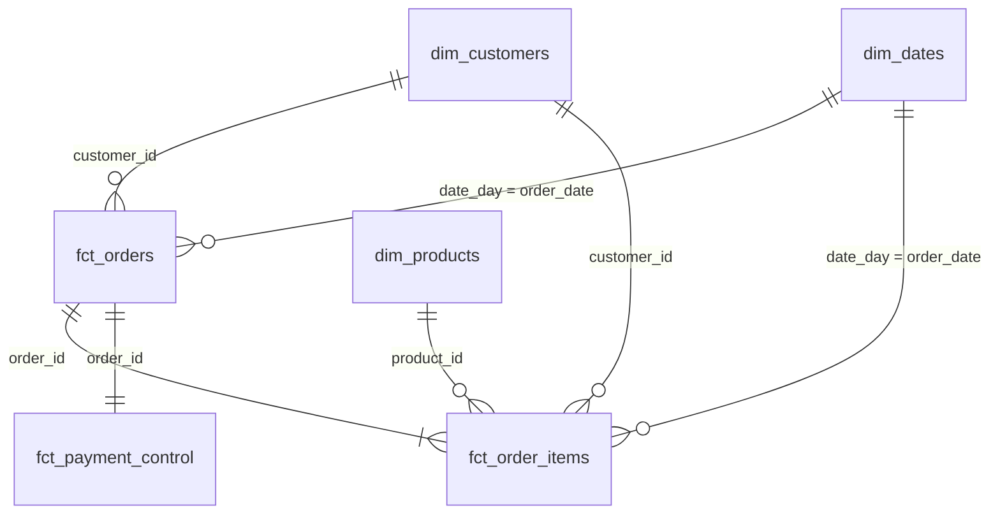
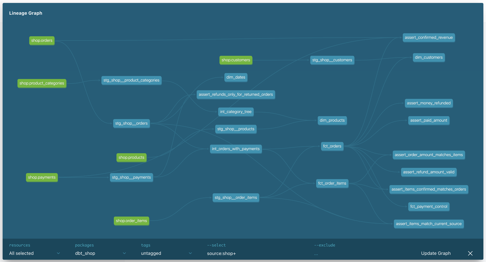

# Аналитический слой интернет-магазина

Проект преобразует сырые данные интернет-магазина в аналитические витрины с использованием dbt.

Исходные данные хранятся в PostgreSQL. Сервис `loader` загружает их в Greenplum, в базу `dwh`, схему `raw`. На их основе dbt строит аналитический слой. Python-скрипты позволяют добавить заказы и платежи, чтобы проверить, как витрины обновляются при изменении данных.

## Слои данных

Данные организованы в 3 слоя:

- **staging**: подготовка и стандартизация исходных данных. По одной модели на каждую таблицу источника, без объединений и агрегаций.
- **intermediate**: промежуточные расчёты, объединение таблиц и дерево категорий. В `int_orders_with_payments` к заказам добавлены итоги по платежам. В `int_category_tree` дерево категорий строится с помощью рекурсивного запроса.
- **marts**: итоговые аналитические витрины и отдельная витрина для контроля оплат и возвратов.

Staging и intermediate создаются как представления в схемах `analytics_staging` и `analytics_intermediate`. Витрины создаются как таблицы в схеме `analytics_marts`.

## Модель данных

В проекте 6 витрин:

| Витрина | Одна строка | На какой вопрос отвечает |
| --- | --- | --- |
| `fct_orders` | Один заказ, тестовые заказы исключены | Сколько подтверждённых заказов и какая выручка по месяцам? Какой средний чек по городам? |
| `fct_order_items` | Один товар в заказе, позиции тестовых заказов исключены | Какая выручка по категориям товаров? Какие бренды чаще возвращают? |
| `dim_customers` | Один клиент, включая клиентов без покупок | Какая доля покупателей по каналам привлечения? Когда клиент сделал первую подтверждённую покупку? |
| `dim_products` | Один товар с названием, брендом и иерархией категорий | К какому бренду, категории и верхнему уровню относится товар? |
| `dim_dates` | Один календарный день, включая дни без заказов | Как меняются продажи по годам, кварталам, месяцам и дням недели? |
| `fct_payment_control` | Один нетестовый заказ | Сколько было оплачено и возвращено? Есть ли переплата? |

Для анализа факты соединяются с измерениями по ключам. Для анализа возвратов к позициям добавляется статус заказа из `fct_orders`.



Подтверждённый заказ — заказ со статусом `paid`, для которого существует хотя бы один успешный платёж. Возврат оплатой не считается. Выручка подтверждённых заказов считается по сумме заказа, а не по сумме платёжных операций.

В `fct_orders` добавлен `items_count` — количество различных товаров в заказе. В `fct_order_items` указаны количество товара, цена, скидка и итоговая стоимость позиции: `quantity * unit_price - discount_amount`.

В `dim_customers` добавлены первая подтверждённая покупка, количество и общая сумма подтверждённых заказов, признак `is_buyer`. У клиентов без покупок количество и сумма равны 0, первая покупка — `NULL`.

В `dim_products` указаны категория товара, родительская и корневая категории. Календарь `dim_dates` покрывает все даты от первого до последнего заказа.

### Контроль оплат и возвратов

В `fct_payment_control` собраны суммы по каждому нетестовому заказу:

- `paid_amount` — сумма успешных оплат без возвратов;
- `refunded_amount` — сумма успешных возвратов, показанная положительным числом;
- `net_paid_amount` — оплаты минус возвраты;
- `overpaid_before_refunds` — насколько оплаты превысили стоимость заказа до возвратов;
- `payment_state` — заказ не оплачен, оплачен частично, полностью или с переплатой;
- `refund_state` — возврата нет, он частичный, полный или превышает сумму оплат.

Состояние оплаты и состояние возврата указаны отдельно. Например, полностью оплаченный заказ после частичного возврата имеет `payment_state = 'paid'` и `refund_state = 'partial_refund'`.

В этом проекте частичный возврат оставляет заказ в статусе `paid`. После полного возврата заказ получает статус `returned`, а `net_paid_amount` становится равным 0. Стоимость заказа и его товарных позиций при денежном возврате не уменьшается.

`overpaid_before_refunds` показывает переплату до возвратов. Это не сумма текущего долга перед покупателем. `net_paid_amount` показывает, сколько денег осталось после возвратов, и не является прибылью.

### Хранение в Greenplum

| Витрина | Распределение | Хранение и причина выбора |
| --- | --- | --- |
| `fct_orders` | `distributed by (order_id)` | Обычная строковая таблица. Заказы соединяются с позициями по `order_id`. |
| `fct_order_items` | `distributed by (order_id)` | Колоночная append-optimized таблица. В отчётах часто нужны отдельные столбцы, например количество и сумма позиции. |
| `fct_payment_control` | `distributed by (order_id)` | Одна строка на заказ; данные об оплатах берутся из `fct_orders`. |
| `dim_customers` | `distributed replicated` | Небольшое измерение хранится на каждом сегменте для соединения с фактами без пересылки его строк. |
| `dim_products` | `distributed replicated` | Небольшой справочник товаров хранится на каждом сегменте. |
| `dim_dates` | `distributed replicated` | Небольшой календарь хранится на каждом сегменте и используется в обоих фактах. |

В сырых таблицах `raw.orders`, `raw.order_items` и `raw.payments` тоже используется распределение по `order_id`. Одинаковый ключ распределения у `fct_orders` и `fct_order_items` позволяет соединять их по `order_id` без перераспределения строк между сегментами. При разных ключах для такого соединения может понадобиться пересылка данных.

Название **append-optimized** относится к хранению таблицы в Greenplum. Способ обновления модели dbt описан ниже.

### Граф зависимостей



## Сценарии изменения данных

В папке `scripts` находятся скрипты для подключения к PostgreSQL, добавления и оплаты отдельного заказа. Скрипт `scenarios.py` создаёт шесть дополнительных ситуаций:

| Заказ | Что происходит |
| --- | --- |
| `910001` | Одна полная оплата |
| `910002` | Оплата двумя платежами: 1200 и 800 |
| `910003` | Два платежа по 2000 при стоимости заказа 2000 |
| `910004` | Полный возврат 2000 |
| `910005` | Частичный возврат 500 |
| `910006` | Изменение количества, цены и скидки позиции, затем оплата 2300 |

Сценарии разделены на три этапа: создание неоплаченных заказов (`prepare`), добавление оплат (`pay`), возвраты и изменение позиции (`changes`). Между этапами данные переносятся в Greenplum и модели запускаются повторно. Так проверяется обновление уже загруженного заказа.

У платежей постоянные номера. При повторном запуске скрипт сравнивает данные существующего платежа и не добавляет его второй раз. Если тот же номер относится к другим данным, скрипт останавливается с ошибкой.

Заказы `910001–910006` созданы для проверки проекта, но в базе имеют обычные статусы `pending`, `paid` или `returned`. Они попадают в витрины. Тестовым для логики моделей считается заказ со статусом `test`.

## Инкрементальная загрузка

Витрина `fct_order_items` использует `materialized='incremental'`, ключ `order_item_id` и стратегию `delete+insert`. Ключ позиции состоит из номера заказа и номера товара через дефис.

При повторном запуске текущие позиции сравниваются с уже загруженными:

- новая позиция добавляется;
- изменённая позиция заменяется по `order_item_id`;
- позиция без изменений повторно не записывается.

Сравниваются количество, цена, скидка, итоговая сумма, клиент, дата заказа и `is_confirmed`. Поэтому после оплаты или возврата обновляется и ранее загруженная позиция.

Отдельный макрос убирает из витрины позиции, которых больше нет в источнике, а также позиции заказов, ставших тестовыми. Исходные таблицы PostgreSQL он не изменяет.

Для поиска отличий модель читает весь текущий набор позиций. Сервис `loader` также полностью обновляет таблицы `raw` при каждом запуске.

## Проверка качества данных

Для проверки таблиц и представлений используются generic и singular тесты.

Generic-тесты проверяют уникальность и заполненность ключей, связи фактов с измерениями и допустимые значения статусов. Свой тест `non_negative` проверяет, что суммы и количества не меньше нуля. В витрине контроля платежей проверяются уникальность номера заказа и допустимые состояния оплаты и возврата.

Singular-тесты проверяют:

1. Сумма заказа равна сумме стоимости его позиций.
2. Сумма подтверждённых покупок в витрине совпадает с суммой, посчитанной по исходным заказам и платежам.
3. По полностью возвращённому заказу `net_paid_amount = 0`.
4. У подтверждённого заказа сумма оплат не превышает его стоимость.
5. Возврат относится к заказу со статусом `paid` или `returned`.
6. Сумма возврата не превышает сумму оплат; полный возврат не оставляет заказ в статусе `paid`.
7. Значение `is_confirmed` совпадает у заказа и его позиций.
8. Позиции в витрине соответствуют текущим данным по составу, количеству, цене, скидке и сумме.

Тест `assert_paid_amount` настроен с `severity='warn'`. Он находит исходный заказ **113**: сумма заказа — **200**, но прошло два успешных платежа по **200**. В новых сценариях он также находит заказ **910003** с двумя платежами по **2000** при стоимости заказа **2000**. Данные не исправляются автоматически: предупреждение показывает обе переплаты.

При последнем запуске тестов результат был: **81 PASS, 1 WARN, 0 ERROR**. Предупреждение относится к `assert_paid_amount`.

## Запуск проекта

Команды выполняются из папки проекта при запущенном Docker:

```bash
docker compose up -d
python scripts/run_pipeline.py
```

Скрипт run_pipeline.py последовательно запускает загрузку данных и dbt build. При ошибке он останавливается. Результат и подробный вывод записываются в pipeline.log.

## Документация

Описания моделей и колонок находятся в YAML-файлах. Обзор проекта и определение подтверждённого заказа записаны в `models/docs.md`. В описаниях `is_confirmed` витрин используется `{{ doc("confirmed_order") }}`.

Папки `target/`, `logs/`, виртуальное окружение `.venv/` и файл `pipeline.log` создаются при работе проекта и исключены из репозитория через `.gitignore`.