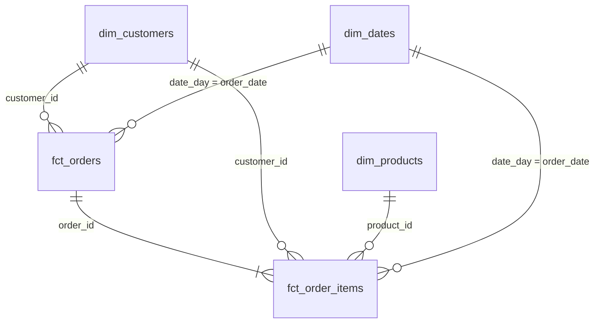

# Аналитический слой интернет-магазина

Проект преобразует сырые данные интернет-магазина в аналитические витрины с использованием dbt.

Исходные данные хранятся в PostgreSQL. Сервис `loader` загружает их в Greenplum, в базу `dwh`, схему `raw`. На их основе dbt строит аналитический слой.

## Слои данных

Данные организованы в 3 слоя:

- **staging**: подготовка и стандартизация исходных данных. По одной модели на каждую таблицу источника, без объединений и агрегаций.
- **intermediate**: промежуточные расчеты, объединение таблиц и дерево категорий. В `int_orders_with_payments` к заказам добавлены итоги по платежам. В `int_category_tree` дерево категорий строится с помощью рекурсивного запроса.
- **marts**: итоговые аналитические витрины по схеме «звезда».

Staging и intermediate создаются как представления в схемах `analytics_staging` и `analytics_intermediate`. Витрины создаются как таблицы в схеме `analytics_marts`.

## Модель данных

В проекте 5 витрин:

| Витрина | Одна строка | На какой вопрос отвечает |
| --- | --- | --- |
| `fct_orders` | Один заказ, тестовые заказы исключены | Сколько подтверждённых заказов и какая выручка по месяцам? Какой средний чек по городам? |
| `fct_order_items` | Один товар в заказе, позиции тестовых заказов исключены | Какая выручка по категориям товаров? Какие бренды чаще возвращают? |
| `dim_customers` | Один клиент, включая клиентов без покупок | Какая доля покупателей по каналам привлечения? Когда клиент сделал первую подтверждённую покупку? |
| `dim_products` | Один товар с названием, брендом и иерархией категорий | К какому бренду, категории и верхнему уровню относится товар? |
| `dim_dates` | Один календарный день, включая дни без заказов | Как меняются продажи по годам, кварталам, месяцам и дням недели? |

Для анализа факты соединяются с измерениями по ключам. Для анализа возвратов к позициям добавляется статус заказа из `fct_orders`.

Подтверждённый заказ — заказ со статусом `paid`, для которого существует хотя бы один успешный платеж. Возврат оплатой не считается. Выручка подтверждённых заказов считается по сумме заказа, а не по сумме платежных операций.

В `fct_orders` добавлен `items_count` — количество различных товаров в заказе. В `fct_order_items` указаны количество товара, цена, скидка и итоговая стоимость позиции: `quantity * unit_price - discount_amount`.

В `dim_customers` добавлены первая подтверждённая покупка, количество и общая сумма подтверждённых заказов, признак `is_buyer`. У клиентов без покупок количество и сумма равны 0, первая покупка — `NULL`.

В `dim_products` указаны категория товара, родительская и корневая категории. Календарь `dim_dates` покрывает все даты от первого до последнего заказа.

### Хранение в Greenplum

| Витрина | Распределение | Хранение и причина выбора                                                                                                    |
| --- | --- |------------------------------------------------------------------------------------------------------------------------------|
| `fct_orders` | `distributed by (order_id)` | Обычная строковая таблица. Заказы соединяются с позициями и платежами по `order_id`.                                         |
| `fct_order_items` | `distributed by (order_id)` | Колоночная append-optimized таблица. В отчётах часто нужны только отдельные столбцы, например количество и сумма позиции.    |
| `dim_customers` | `distributed replicated` | Обычная строковая таблица. Небольшое измерение хранится на каждом сегменте для соединения с фактами без пересылки его строк. |
| `dim_products` | `distributed replicated` | Обычная строковая таблица. Небольшой справочник товаров хранится на каждом сегменте.                                         |
| `dim_dates` | `distributed replicated` | Обычная строковая таблица. Небольшой календарь хранится на каждом сегменте и используется в обоих фактах.                    |

В сырых таблицах `raw.orders`, `raw.order_items` и `raw.payments` тоже используется распределение по `order_id`. Одинаковый ключ распределения у `fct_orders` и `fct_order_items` позволяет соединять их по `order_id` без перераспределения строк между сегментами. При разных ключах для такого соединения может понадобиться пересылка данных.

### Граф зависимостей

## Проверка качества данных

Для проверки корректности составленных таблиц и представлений используются generic и singular тесты.

Generic-тесты проверяют уникальность и заполненность первичных ключей, связи фактов с измерениями и допустимые статусы заказов и платежей. Свой тест `non_negative` проверяет, что суммы и количества не меньше нуля.

Singular-тесты проверяют:

1. Сумма заказа равна сумме стоимости его позиций.
2. Сумма подтверждённых покупок в витрине совпадает с суммой, посчитанной по исходным заказам и платежам.
3. По возвращённому заказу деньги вернулись полностью: `net_paid_amount = 0`.
4. Подтверждённому заказу не списали больше его суммы.
5. Возвраты относятся только к заказам со статусом `returned`.

Тест `assert_paid_amount` настроен с `severity='warn'`. Он находит заказ **113**: сумма заказа — **200**, но прошло два успешных платежа по **200**. Всего списано **400**. Исходные данные сохранены, предупреждение показывает реальную проблему двойного списания.

## Инкрементальная загрузка

Витрина `fct_order_items` использует инкрементальную загрузку новых товарных позиций. Настроены `materialized='incremental'`, `unique_key='order_item_id'` и стратегия `append`.

Ключ позиции состоит из номера заказа и номера товара через дефис. При повторном запуске через `is_incremental()` проверяется, есть ли такой ключ в витрине. Добавляются только новые позиции, в том числе новые позиции старых заказов.

Изменения ранее загруженных позиций автоматически не обновляются. Модель пропустит изменения количества, цены, скидки, клиента, даты и статуса заказа, а также новые платежи, которые меняют `is_confirmed`. Удалённые в источнике позиции останутся в витрине. Если заказ станет тестовым, его ранее загруженные позиции тоже останутся.

Чтобы учесть такие изменения, нужно полностью пересобрать витрину

## Документация

Описания моделей и колонок находятся в YAML-файлах. Обзор проекта и определение подтверждённого заказа записаны в `models/docs.md`. В описаниях `is_confirmed` витрин используется `{{ doc("confirmed_order") }}`.

